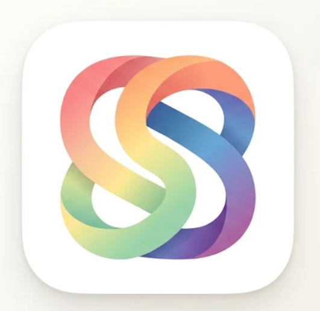

<p align="center">
  
</p>

<h1 align="center">S.A.T.I.O Verse</h1>

<p align="center">
  一个能住在你电脑里的角色外壳 —— 3D 房间是她的家，终端是她的嘴，插件是她的本事。
</p>

<p align="center">
  <a href="https://satio-verse.gitgraduate.com">官网</a> ·
  <a href="https://satio-verse.gitgraduate.com/#start">快速开始</a> ·
  <a href="https://github.com/satio-verse/satio-plugins">插件目录</a>
</p>

> 本仓库 = 你连接「她」的物理外壳与监视器；角色的人格、声音、记忆属于各自的实例，不在这份仓库里。

## 这是什么

- **桌面主窗口**：S.A.T.I.O —— 全屏 3D 客厅 + 底部胶囊对话 + 游戏化 HUD（认知流 / 记忆星图 / 能力阵列 / 数据大盘）
- **能力层**：插件与「世界」（VRChat 式空间、聊天、游戏）通过 wmworld.json 契约接入
- **本机优先**：LLM、TTS、语音识别都在你自己的机器上跑，密钥不上传；没有模型时自动退化为 mock
- **可自己扩展**：布置器改房间、插件改本事、世界改她能去哪

## 快速开始

```bash
python -m venv .venv && . .venv/Scripts/activate
pip install -r requirements.txt
python -m wm.services up
# 打开 http://127.0.0.1:8790/pet/satio.html
```

没有模型也能跑：config/local.json 里把引擎切成 mock。

## 下载与更新

见 docs/下载与更新.md：Releases 是主下载源，Pages 与自建镜像备份；
插件通过市场「装前报告」安装，默认停用、默认最小权限。

## 社区与贡献

- 插件/世界目录：satio-plugins 仓库（PR + CI 契约校验）
- 讨论与提案：Discussions / Issues
- 贡献前读 CONTRIBUTING.md 与 CODE_OF_CONDUCT.md；安全问题见 SECURITY.md

## 许可证

- 代码：**Apache-2.0**；文档与文字：**CC BY-NC 4.0**；第三方组件见 NOTICE
- 为什么这么选、以及「如何防止被复刻」的实话，见 docs/许可证与商标说明.md

## 不在本仓库里的东西

角色人格文档、声音模型、VRM 模型、记忆库、聊天日志、config/local.json。
想跑起来需要自己准备一个 VRM（或用 2D 兜底）与一份人格设定。

---

---

## 早期说明（2026-11-19 版）

完整的旧版说明（包含 2026-11-19 时的全部功能、配置与测试数字）已移到 [docs/早期说明-2026-11-19.md](docs/早期说明-2026-11-19.md)，本页只保留能让人跑起来的部分。
